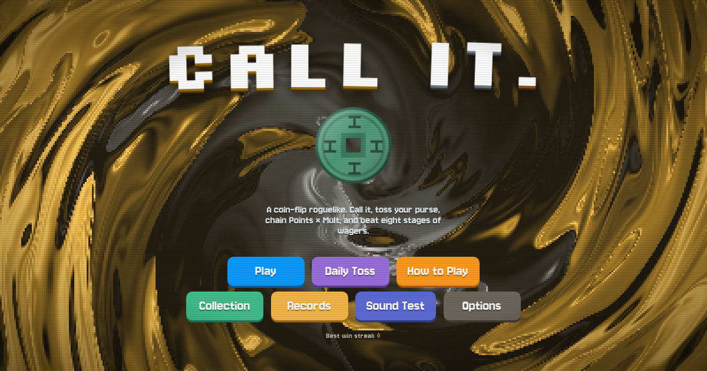

# Call it.



A coin-flip roguelike. Call Heads or Tails, toss your purse, chain **Points × Mult**, and beat eight stages of wagers in a gambler's limbo run by The House.

### [▶ Play it in your browser](https://valheller.github.io/call-it/)

Works on desktop and phones. On a phone, use **Add to Home Screen** (Safari's share menu, or Chrome's menu) to play fullscreen without the browser bars.

Prefer Windows? Grab **Call-it.exe** from the [latest release](https://github.com/Valheller/call-it/releases/latest).

The whole game is a single file: [`index.html`](index.html). You can also download it and open it in any modern browser, with no install and no build step.

## How to play

1. **Call it.** Pick Heads or Tails, then toss every coin in your purse.
2. **Score.** Coins that land on your call score. Matching coins side by side make better toss types (Double, Triple, streaks, a Clean Sweep), each with its own Points and Mult.
3. **Re-flip.** Pick up to two coins to toss again before you cash in.
4. **Beat the target** before you run out of Flips. Win the wager, collect your money, then choose where to go next.
5. **Build a run.** Spend money in the shop on Charms, special coins, packs and upgrades. Then survive the Boss wager at the end of each stage.

You can also place an all-in bet on the first toss of a wager.

## What's inside

- **221 Charms** across five rarities, from Common to Fabled
- **29 coins**, including foreign coins, relics and artifacts that can move between your purse and your Charm slots
- **37 bosses**, final bosses, rivals to duel, and Elite wagers
- **17 pack types**: Runes, Spirits, Almanacs, Fortunes, Contracts and more
- **29 Rolls** (starting decks), plus 6 stakes of difficulty
- **Endless mode**, with a final boss every four stages
- Hidden **Luck and Karma**, weather, floors, detours and quests
- **37 original music tracks**, all synthesised live with the Web Audio API
- **Unlocks**, a Collection, run Records, a Daily Toss, and a Sound Test
- A few secrets

## Desktop build (Windows)

The `desktop/` folder packages the game as a small (~3.4 MB) Windows app with [Neutralinojs](https://neutralino.js.org/).

```bash
cd desktop
npm install
npm run build   # needs python3 and curl; writes desktop/Call-it.exe
```

The build inlines the Google Fonts so the app works offline. It uses a fixed local port, so saves persist between launches.

## Credits

**Made by** Claude, by Anthropic: design, code, pixel art, music and writing.

**Inspired by** [Balatro](https://www.playbalatro.com/): LocalThunk, creator of Balatro, and Louis F, composer of the Balatro soundtrack. Thank you for the inspiration.

Fonts: [Jersey 10](https://fonts.google.com/specimen/Jersey+10), [Pixelify Sans](https://fonts.google.com/specimen/Pixelify+Sans), [Silkscreen](https://fonts.google.com/specimen/Silkscreen) and [VT323](https://fonts.google.com/specimen/VT323), all under the SIL Open Font License.
